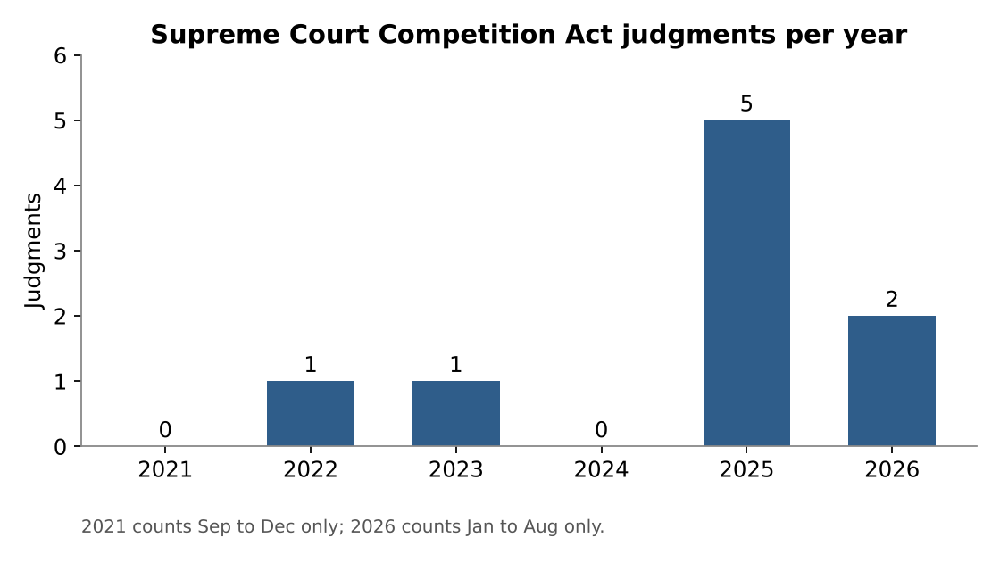
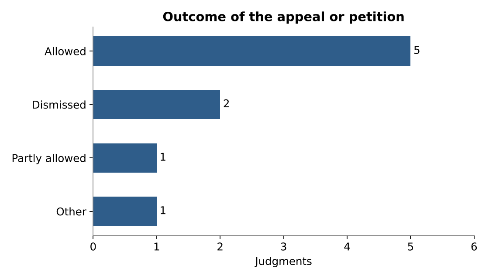
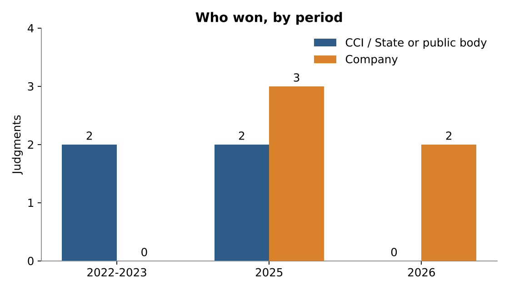

# Competition law in the Supreme Court of India, 2021 to 2026

Analysis page: https://shreya23010422057-crypto.github.io/competition-law-judgments/

## Team

- Shreya Kotecha, Section C
- Madhura Kulkarni, Section C
- Shankar Singh, Section C

## Topic

We studied how the Supreme Court of India has dealt with cases under the Competition Act, 2002. Two of us are taking the Competition Law elective, and we wanted to see whether the Court has been widening the Competition Commission of India's (CCI) powers or holding it to tighter standards. The Supreme Court hears only a handful of these cases each year, so it was possible to try to capture all of them.

## How we found the judgments

We searched the Supreme Court's judgment portal (sci.gov.in) and Indian Kanoon for "Competition Act, 2002", "Competition Commission of India" and "Section 53T" between 1 September 2021 and 31 August 2026. We cross-checked the results against year-end case roundups published by law firms and legal news sites, which listed about twenty Supreme Court matters involving the CCI in this period.

We kept only reasoned judgments and orders that gave reasons. We left out interim orders on stays and deposits (for example Google LLC v. CCI, January 2023, and United Breweries v. CCI, February 2023), transfer orders, and appeals dismissed without reasons (for example CCI v. JCB India, December 2024, and CCI v. Grasim Industries, July 2026). That left nine entries. Seven are full judgments. Two, CCI v. Monsanto Holdings (September 2025) and Flipkart India v. CCI (February 2026), are short orders that still explain why the Court decided as it did. Each row links to the Court's own copy. For Flipkart we could not find a direct PDF link, so the row gives the case number to look up on sci.gov.in.

## What the data shows

Chart 1 counts judgments by year. Five of the nine come from 2025, and we found none for late 2021 or for 2024. We expected a steadier spread. Part of the 2025 spike comes from the Independent Sugar Corporation litigation, which produced both a judgment in January and a review decision in May.

Chart 2 shows outcomes. Five appeals or petitions were allowed, two were dismissed, one was partly allowed and one is coded "Other". The "Other" case is Coal India v. CCI, where the Court answered only the preliminary question (does the Act apply to Coal India?) and sent the appeal on to be heard on merits. Flipkart is coded "Partly allowed" because the NCLAT order was set aside but the matter went back for a fresh decision. What surprised us is how often the appellant succeeded. The Supreme Court is not simply rubber-stamping the tribunals.

Chart 3 splits the winners by period. The CCI side won both cases in 2022 and 2023, which were about whether the Commission could act at all (lotteries in Mizoram, public sector monopolies in Coal India). In 2025 the results were split, and the cases turned on procedure: show cause notices, cross-examination and proof of actual harm in Schott Glass. Both 2026 rulings went to the companies, with Amazon holding that s 45(2) is a penalty clause and not a power to reopen an approval. Our reading is that the Court has accepted a wide jurisdiction for the CCI and is now policing how it uses that power.

## Limits

Nine cases is too few to call this a trend with confidence. Who wins depends on which parties choose to appeal and on how many CCI cases happen to reach the Court in a given year, so a reader should not conclude that the Court has turned against the regulator. Our "who won" coding is a judgment call, especially for remands, and other readers could code those rows differently.

## AI-use disclosure

We used Claude (Anthropic) to search for candidate judgments, draft the first version of the coding for each row, make the three charts and draft the analysis page and this README. Every judgment was then opened on sci.gov.in by the team member named in the "Coded by" column, who checked the date, bench, outcome, provision, holding and precedent against the official copy and corrected the row where needed. We did not rely on headnotes or AI summaries for any final entry.
